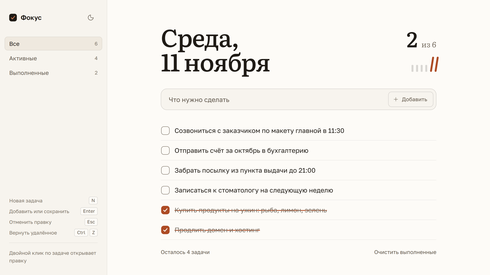
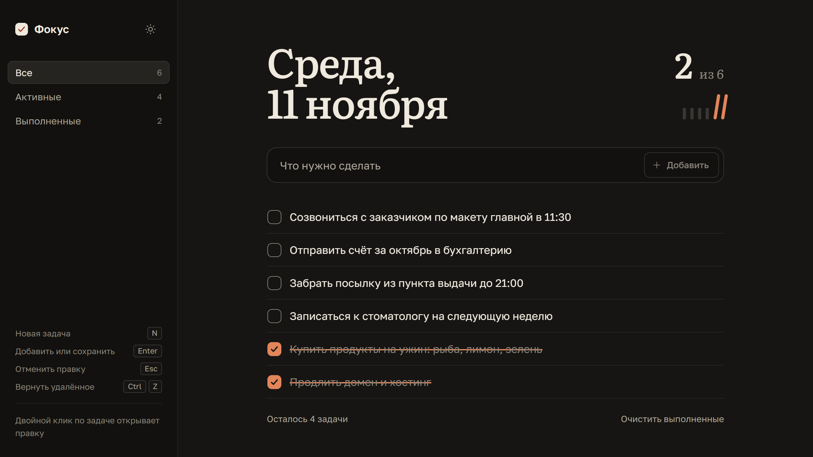
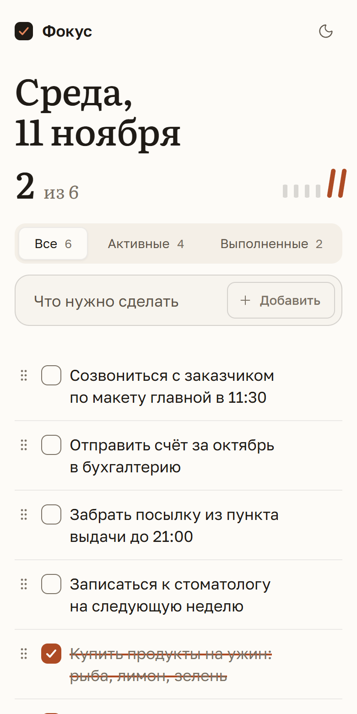

<div align="center">

# Фокус

Список дел на день: быстрый, с клавиатуры, без регистрации. Задачи хранятся в браузере




[Что умеет](#что-умеет) · [Запуск](#запуск) · [Как устроено](#как-устроено) · [Проверка](#проверка)

</div>

---

## Что умеет

Требования задания и то, как они закрыты.

| Требование | Как сделано |
| --- | --- |
| Добавление задач | Клавиша `Enter` или кнопка. Пробелы по краям обрезаются, пустая строка не добавляется — поле подсказывает, что нужно ввести текст |
| Отметка выполненных | Флажок. Текст зачёркивается линией, которая прорисовывается слева направо, отметка прогресса загорается |
| Удаление | Кнопка в строке. Шесть секунд задачу можно вернуть — кнопкой «Вернуть» или `Ctrl` + `Z` |
| Сохранение после обновления страницы | `localStorage`. Сохраняются задачи, их порядок, выбранный фильтр и тема |

Сверх задания:

- **Фильтр** «Все / Активные / Выполненные» со счётчиками
- **Правка на месте** двойным кликом: `Enter` сохраняет, `Esc` отменяет
- **Порядок задач** меняется перетаскиванием за ручку или стрелками с клавиатуры
- **Очистка выполненных** одной кнопкой, тоже с возвратом
- **Счётчик оставшихся** с правильным склонением: «осталась 1 задача», «осталось 5 задач»
- **Светлая и тёмная тема**: по умолчанию как в системе, выбор запоминается, страница не мигает при загрузке
- **Прогресс дня**: счёт «выполнено из всех» и ряд отметок, по одной на задачу. Когда выполнено всё, счёт обводится красным карандашом
- **Две вкладки** с приложением видят изменения друг друга сразу
- **Честное предупреждение**, если браузер запретил хранилище и задачи не переживут закрытие вкладки
- **Телефон**: та же страница перестраивается в одну колонку

<details>
<summary>Тёмная тема и телефон</summary>

<br />





</details>

## Запуск

Нужен Node.js 20.19+ или 22.12+.

```bash
npm install
```

```bash
npm run dev
```

Остальные команды:

| Команда | Что делает |
| --- | --- |
| `npm run build` | Проверка типов и сборка в `dist/` |
| `npm run preview` | Локальный просмотр готовой сборки |
| `npm test` | Тесты логики |
| `npm run lint` | Проверка кода ESLint |

Сборка — обычные статические файлы с относительными путями, поэтому открывается с любого хостинга. На GitHub Pages сайт раздаётся из ветки `gh-pages`, в которой лежит содержимое `dist/`.

## Как устроено

```text
src/
  state/        логика без React: задачи, чтение и запись, стартовые примеры
  hooks/        связь логики с интерфейсом: задачи, тема, сегодняшняя дата
  components/   экран по частям: поле ввода, список, строка, фильтр, прогресс
  lib/          склонение числительных и формат даты
  styles/       tokens.css — цвета, шрифты и тайминги; app.css — всё остальное
```

Решения, которые стоит знать:

- **Вся логика списка — одна чистая функция** (`state/tasks.ts`). Её можно проверить тестами без браузера, а компоненты только показывают результат
- **Запись в хранилище имеет номер версии и проверяется при чтении.** Повреждённые или чужие данные не роняют приложение: битые элементы отбрасываются, остальное загружается
- **Примеры задач показываются только при первом визите.** Если человек сам удалил всё, список остаётся пустым
- **Горячие клавиши привязаны к физическим клавишам**, поэтому `N` и `Ctrl` + `Z` работают и в русской раскладке
- **Всё доступно с клавиатуры**, включая перестановку задач. Действия озвучиваются для экранных читалок, анимации отключаются при системной настройке «уменьшить движение»
- **Никаких внешних запросов.** Шрифты Golos Text и Literata лежат в сборке

Библиотек в работе три: React, [Motion](https://motion.dev) для перестановки и плавных переходов, [Lucide](https://lucide.dev) для иконок. Ещё два пакета — файлы шрифтов.

### Про оформление

Образ — бумажный ежедневник и красный карандаш. Главное на экране — сегодняшняя дата, набранная крупно, как на странице ежедневника. Все поверхности взяты из одной тёплой нейтральной шкалы, а единственный акцентный цвет появляется только там, где что-то сделано: галочка, зачёркивание, отметки под счётом дня и обводка, когда выполнено всё.

Палитра основана на токенах [unslop](https://heydamir.design/unslop) Дамира Соколовского ([@heydamir](https://x.com/heydamir)), CC BY 4.0.

## Проверка

- [x] 33 теста логики: добавление, отметка, правка, удаление, возврат на прежнее место, перестановка под фильтром, чтение повреждённых данных, недоступное хранилище, склонения
- [x] Проверка типов TypeScript в строгом режиме и ESLint — без замечаний
- [x] Сборка проходит и открывается из подпапки, как на GitHub Pages
- [x] В Chrome, 19 сценариев на трёх ширинах (1280, 390 и 320 px, две последние — с касаниями): добавление по `Enter` и кнопкой, отказ на пустой строке, отметка, правка и её отмена, удаление и возврат, перестановка стрелками, фильтры, смена темы, очистка выполненных, отсутствие горизонтальной прокрутки и ошибок в консоли
- [x] После обновления страницы на месте задачи, их порядок, отметки, фильтр и тема
- [x] Анимации сняты по кадрам: зачёркивание, раскрытие темы, перетаскивание, обводка счёта

Не проверялось: Safari и Firefox, настоящие телефоны (в том числе перетаскивание пальцем), экранные читалки на живом устройстве.
